# Diario SQL

## PARTE 1. Mi ruta de aprendizaje individual

Duración: 90 minutos aproximadamente

**Antes de empezar**

Abre SQL Case Files.

Trabaja a tu ritmo. Lee la teoría, ejecuta las consultas, observa los resultados y utiliza las pistas disponibles antes de buscar una solución.

Lleva un pequeño registro de tu aprendizaje. Puedes utilizar un documento, un cuaderno o un archivo Markdown.

### Misión 1. Consigue tus primeras pistas

Tiempo orientativo: 20 minutos

Completa los contenidos introductorios y resuelve los ejercicios iniciales de SQL Case Files.

Al terminar, comprueba que sabes:

-  Consultar información de una tabla con SELECT.
-  Indicar de qué tabla quieres obtener los datos con FROM.
-  Filtrar resultados con WHERE.
-  Combinar condiciones con AND y OR, si aparecen en los contenidos.
-  Ordenar los resultados con ORDER BY, si ya lo has estudiado.

Evidencia: escribe dos consultas que hayas resuelto y explica qué hace cada una.

#### EVIDENCIA 1

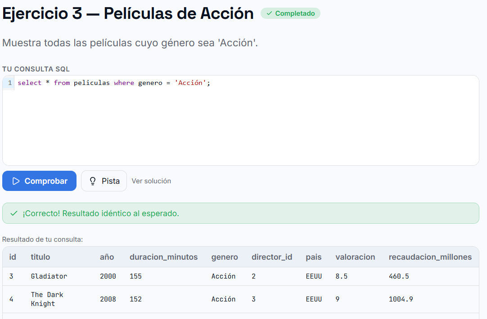

**EXPLICACION:**

- SELECT para decirle que seleccinar en este caso le decimos que todos con un  asterisco
- FROM para decirle que tabla vamos a usar en este caso “peliculas”
- WHERE para decirle una condicion para filtrar los resultados. En este caso que solo muestre las peliculas cuyo genero sea de Acción.
- Aqui la consulta estaba bien, pero me daba error porque hay que tener en cuanta los datos. Y escribirlo tal y como viene y en este caso “Acción” tiene la primera en mayuscula y tilde en la O.

#### EVIDENCIA 2

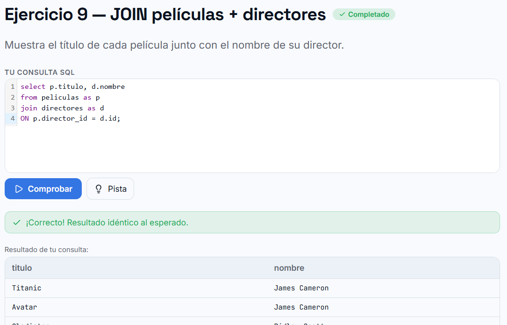

**EXPLICACION:**

-   SELECT seleciona dos columna  la del titulo de la table de peliculas y la de nombre de la tabla de directores.
-   FROM sacamos los datos desde la tabla de peliculas y la asignamos un alias en este caso p

-   JOIN Unimos la tabla de peliculas con la tabla de directores y ademas Tambien le asignamos un alias en este caso para directores la letra d.

-   ON indica cómo se relacionan las dos tablas. En este caso, p.director_id = d.id une cada película con su director, haciendo coincidir el identificador del director guardado en peliculas con el identificador de la tabla directores.

### Misión 2. Sube de nivel

Tiempo orientativo: 25 minutos

Continúa con los ejercicios disponibles en la herramienta.

Busca practicar, cuando estén incluidos en los contenidos:

-  Seleccionar solo las columnas necesarias.
-  Filtrar por varias condiciones.
-  Ordenar los resultados.
-  Calcular cantidades con COUNT().
-  Calcular sumas con SUM().
-  Agrupar resultados con GROUP BY.

Reto de comprensión: antes de ejecutar una consulta, intenta predecir qué resultado devolverá. Después, compara tu predicción con el resultado real.

Evidencia: documenta una consulta que te haya costado resolver y explica cómo lo conseguiste.

#### EVIDENCIA 1

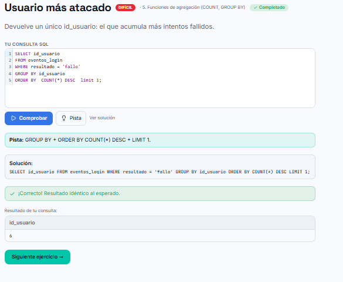

En esta consulta me atasque , mire la pista para que me ayudase pero tampoco lo hizo, asi que fui a la documentacion y no veia el fallo. Al final tuve que usar la solucion ya que lo que me fallaba era la logica del ejercicio ya que queria sumar los usuarios no contar los intentos que acumulaba el usuario.

### Misión 3. Entra en SQL Agent

Tiempo orientativo: 30 minutos

Accede a SQL Agent y resuelve ejercicios de mayor dificultad.

1. Elige un reto que te suponga un esfuerzo.
2. Intenta resolverlo sin mirar la solución.
3. Si te bloqueas, vuelve a leer la teoría o utiliza las pistas disponibles.
4. Cuando consigas resolverlo, explica por qué funciona tu consulta.
5. Si terminas pronto, selecciona otro reto de dificultad superior.

Regla de oro: no copies una solución sin entenderla. Si puedes explicar la consulta con tus propias palabras, estás aprendiendo.

#### EVIDENCIA 1

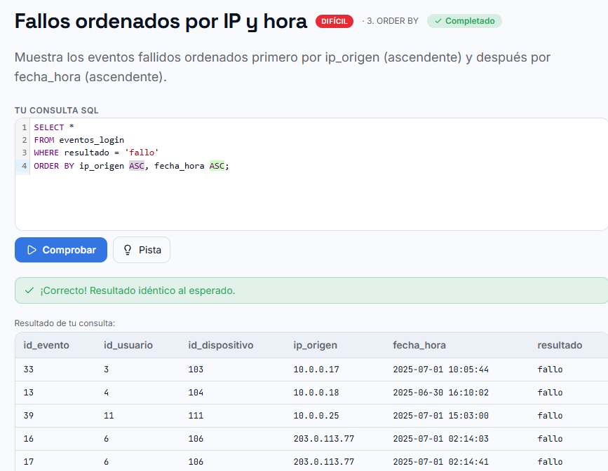

**EXPLICACION:**
- SELECT *: muestra todas las columnas.
- FROM eventos_login: obtiene los datos de la tabla eventos_login.
- WHERE resultado = 'fallo': muestra únicamente los eventos fallidos.
- ORDER BY ip_origen ASC, fecha_hora ASC: ordena primero por la IP de origen en sentido ascendente. Cuando varios eventos tienen la misma IP, los ordena por fecha y hora, del más antiguo al más reciente.

#### EVIDENCIA 2

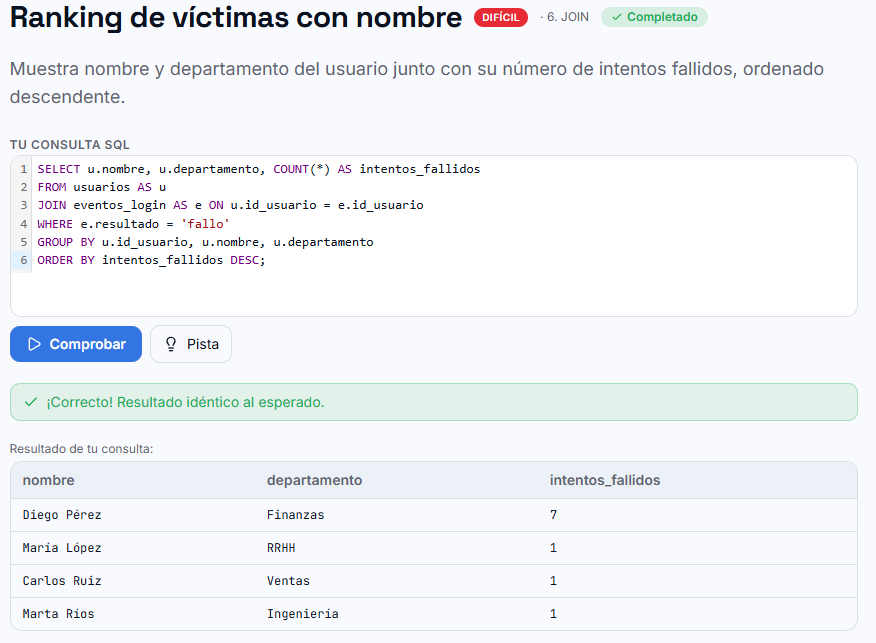

**EXPLICACION:**

- SELECT u.nombre, u.departamento: muestra el nombre y el departamento del usuario.
- COUNT(*) AS intentos_fallidos: cuenta los intentos fallidos de cada usuario y llama a esa columna intentos_fallidos.
- FROM usuarios AS u: utiliza la tabla usuarios y le asigna el alias u.
- JOIN eventos_login AS e: une los usuarios con sus eventos de inicio de sesión. El alias e permite referirse a esos eventos.
ON u.id_usuario = e.id_usuario: relaciona las filas que tienen el mismo identificador de usuario.
- WHERE e.resultado = 'fallo': conserva únicamente los intentos fallidos.
- GROUP BY u.id_usuario, u.nombre, u.departamento: reúne los intentos de cada usuario para que COUNT(*) calcule cuántos tiene. El identificador evita mezclar a personas que se llamen igual.
- ORDER BY intentos_fallidos DESC: ordena el resultado de mayor a menor número de fallos.

### Misión 4. Mi registro de aprendizaje

Tiempo orientativo: 15 minutos

Completa estas frases:

-  **Una consulta SQL sirve para…** consultar y trabajar con  los datos.
-  **La instrucción que mejor entiendo es…** Select … from ... creo que es la mas facil
-  **La instrucción que todavía me cuesta es…** count con order by cuando se complica la consulta
- **El error más interesante que he encontrado es…** olvidarme poner el nombre de la columna
-  **Una cosa que ahora puedo hacer y antes no sabía hacer es**…utilizar los alias sin liarme

**Lista de comprobación individual**

**Lista de comprobación individual**

- ✅ He trabajado los contenidos introductorios.
- ✅ He ejecutado consultas y observado sus resultados.
- ✅ He intentado resolver ejercicios sin copiar directamente.
- ✅ He probado al menos un reto avanzado o una actividad de refuerzo.
- ✅ He documentado mis aprendizajes y mis dudas.

## PARTE 2. Elige tu siguiente nivel

Cuando termines las misiones anteriores, elige el itinerario que mejor se adapte a tu progreso.

No es una competición. Puedes cambiar de nivel si lo necesitas.

### Nivel 1. Exploradora SQL — Necesito consolidar

Tu objetivo es comprender los fundamentos.

1. Escribe una consulta que muestre todas las columnas de una tabla.

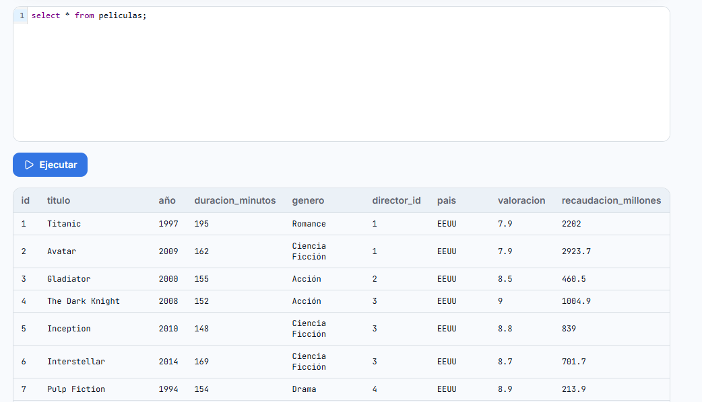

2. Escribe otra que muestre únicamente dos columnas.

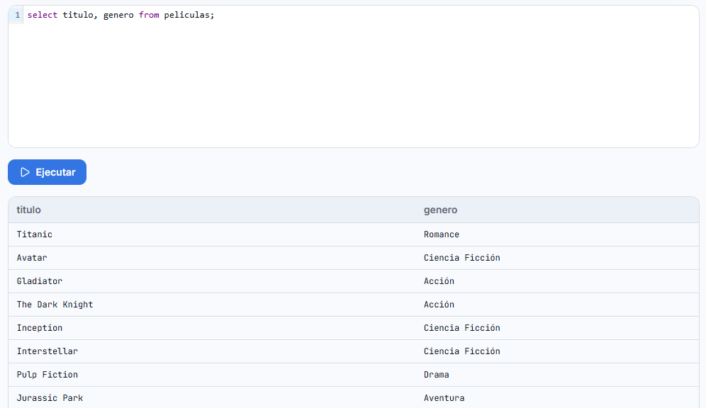

3. Filtra los resultados usando una condición.

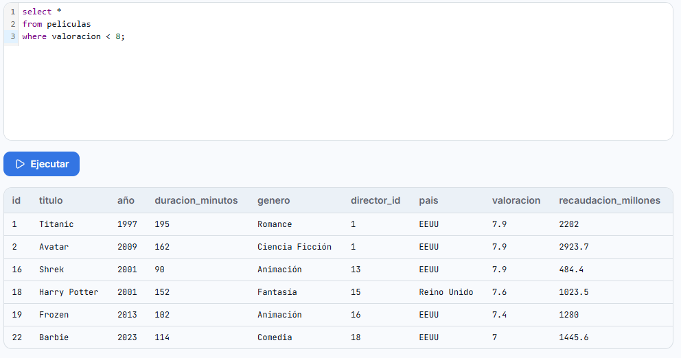

4. Ordena los resultados por una columna.

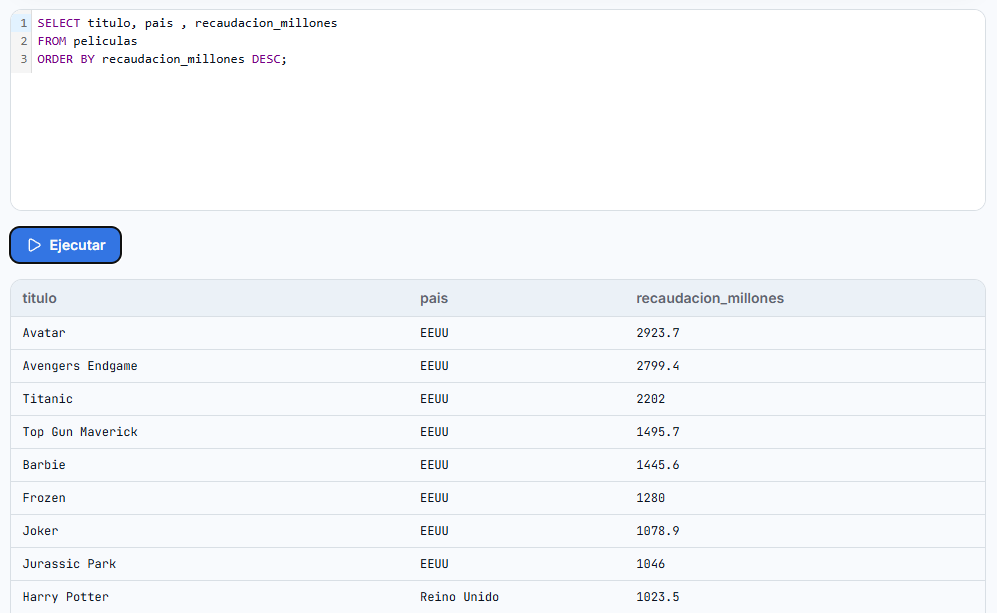

5. Explica la diferencia entre WHERE y ORDER BY.

    -    **WHERE** decide que filas se muestran aplicando un condicion,  si cumple la condicion se muestra si no lo excluye.

    -    **ORDER BY** decide en que orden aparecen los datos: ascendente (asc) o descendiente(desc)

Condición para avanzar: poder explicar qué hace cada instrucción sin leer la solución.

### Nivel 2. Analista SQL — Ya controlo lo básico

Tu objetivo es obtener información resumida.

1. Cuenta cuántos registros tiene una tabla.

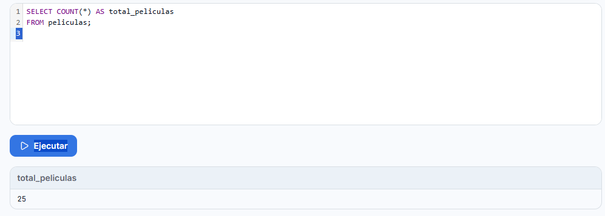

2. Calcula la suma de una columna numérica.

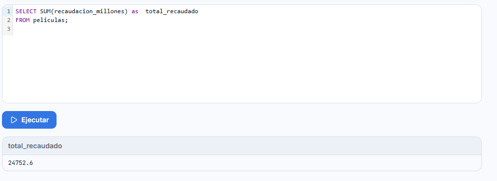

3. Agrupa los registros por una categoría.

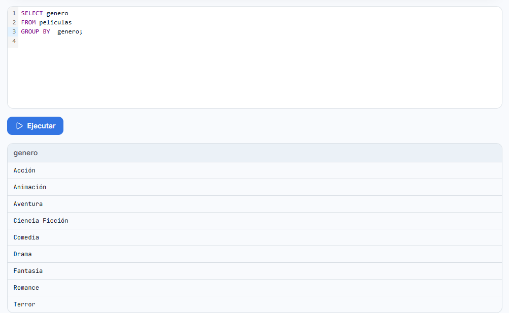

4. Cuenta cuántos registros hay en cada categoría.

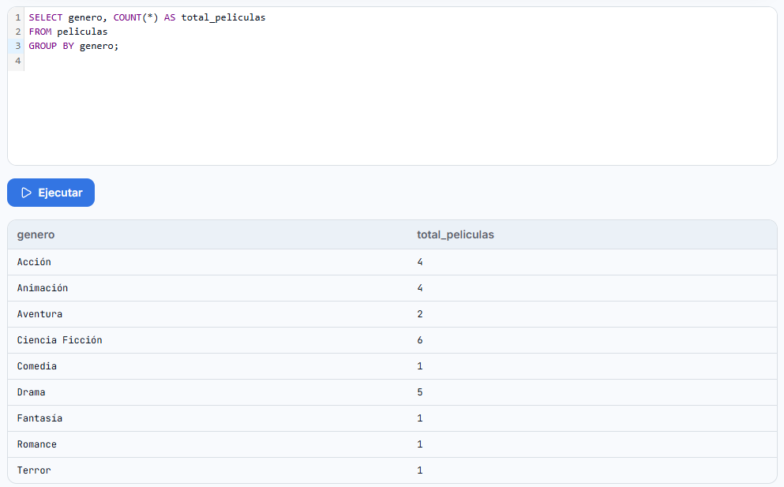

5. Ordena los grupos para identificar el mayor o el menor.

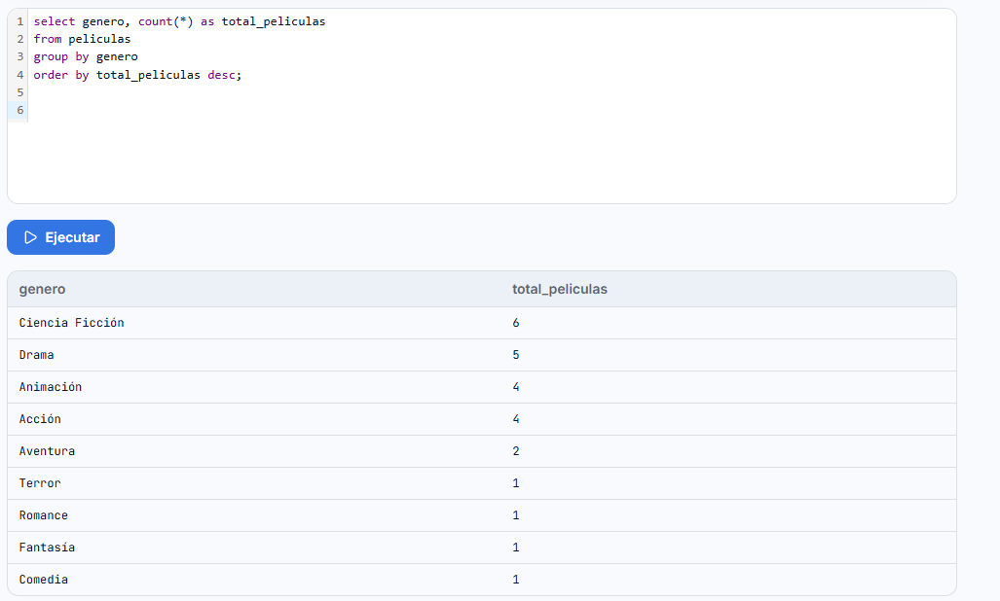

Si ya conoces HAVING, úsalo para filtrar los grupos después de calcular sus resultados.

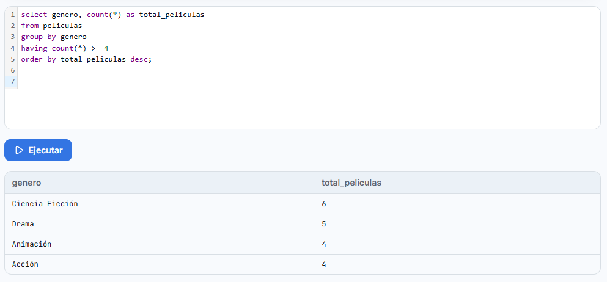

Condición para avanzar: resolver una pregunta utilizando una función de agregación y explicar su resultado.

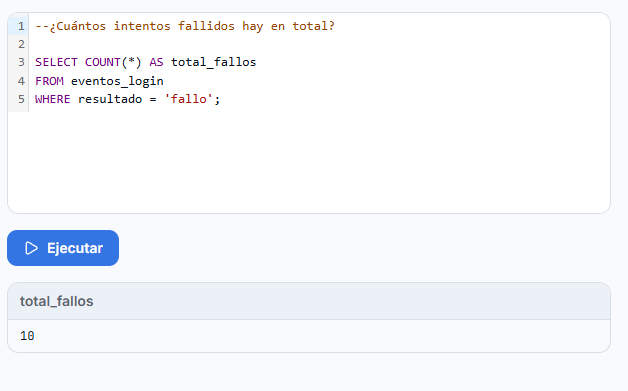

**EXPLICACION:**
- FROM eventos_login: obtiene los datos de la tabla de eventos.
- WHERE resultado = 'fallo': selecciona únicamente los intentos fallidos.
- COUNT(*): cuenta las filas que cumplen esa condición.
- AS total_fallos: asigna un nombre a la columna del resultado.
El resultado es una única fila con el número total de intentos fallidos. 

### Nivel 3. Especialista SQL — Quiero ir más lejos

Tu objetivo es combinar información y resolver problemas complejos.

1. Identifica dos tablas relacionadas en el esquema de datos disponible.

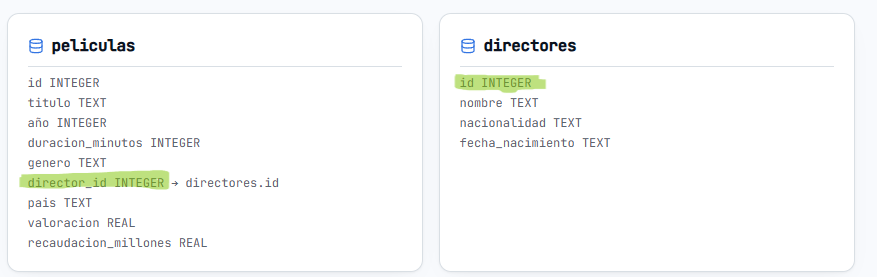

La tabla de pelicula tiene la columna “director_id” que se relaciona con la table de directores con la columna “id”

2. Averigua qué columnas permiten relacionarlas.

-  La columna director_id de la tabla peliculas se relaciona con la columna id de la tabla directores.
-  La columna pelicula_id de la tabla peliculas_actores se relaciona con la columna id de la tabla peliculas.
-  La columna actor_id de la tabla peliculas_actores se relaciona con la columna id de la tabla actores.

3. Utiliza JOIN para combinar información, si está incluido en el entorno.

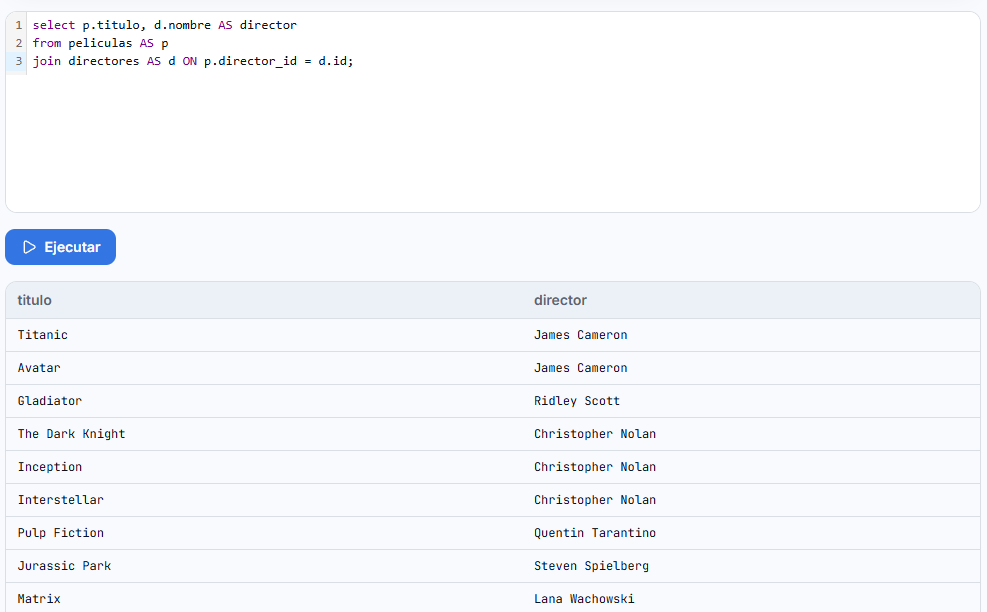

4. Calcula una métrica a partir de los datos combinados.

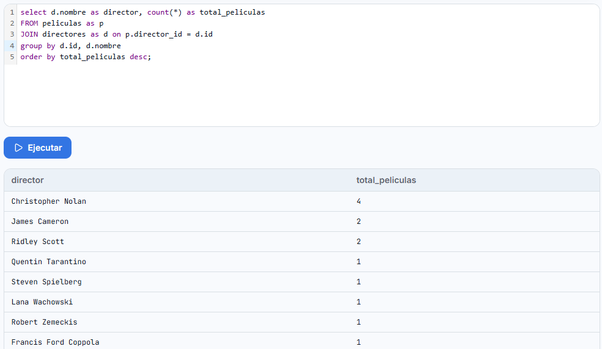

5. Formula una pregunta nueva que pueda responderse con una consulta SQL.

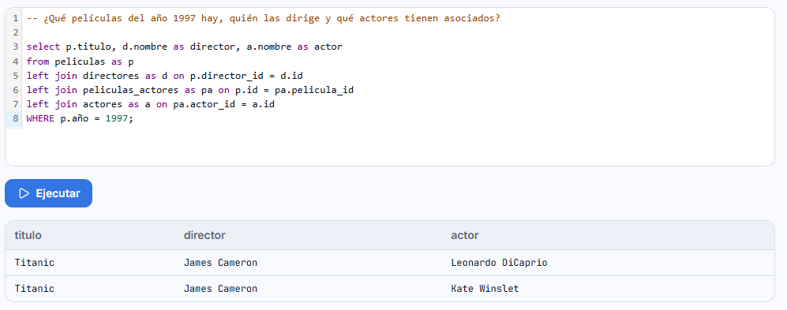

6. Comprueba que tu consulta responde realmente a la pregunta.

Solo hay una pelicula pero dos actores por eso aparecen dos filas.

Reto adicional: si ya conoces las subconsultas o las funciones de ventana, intenta resolver el mismo problema con una técnica diferente.

Condición para completar el nivel: documentar una consulta que combine al menos dos operaciones y explicar qué aporta cada una.

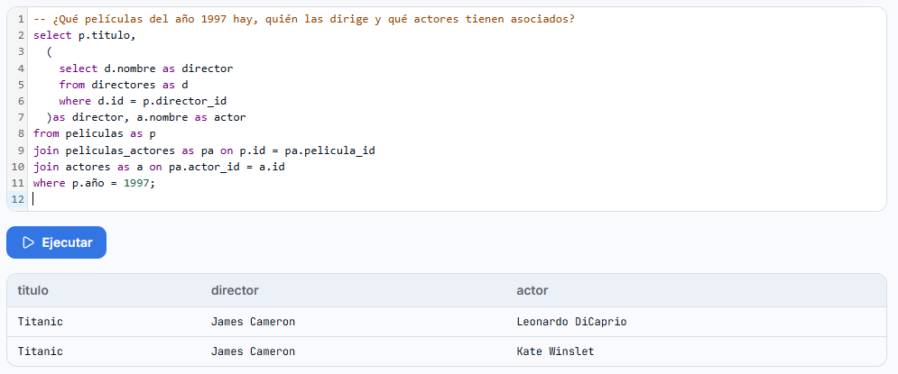

La subconsulta entre parentesis busca el nombre del director de  cada pelicula. Relaciona en la table de directores con id con la tabla de peliculas director_id y muestra el resultado en la columna del director

## PARTE 4. Autoevaluación final

Antes de entregar el trabajo, cada persona debe completar individualmente esta reflexión.

- ✅  Sé consultar datos de una tabla.
- ✅  Sé filtrar y ordenar resultados.
- ✅  Comprendo para qué sirven las funciones de agregación.
- ✅  He intentado al menos un reto de SQL Agent.
- ✅  He guardado ejemplos de consultas y mis aprendizajes.
- ✅  Puedo explicar al menos una consulta que he escrito.
- ✅  He identificado qué necesito seguir practicando.

**ENTREGABLE:**

1. Registro de consultas SQL

Cada alumna guardará 3 consultas realizadas en SQL Case Files:

-  Una consulta básica que haya comprendido.
-  Una consulta que utilice algún filtro u ordenación, si estos contenidos están disponibles.
-  Una consulta que le haya resultado difícil o que haya supuesto un reto.

Para cada consulta deberá incluir el código SQL, qué resultado obtiene y una explicación breve de cómo funciona.

2. Reto de SQL Agent

Documentará al menos un reto que le haya supuesto esfuerzo:

-  ¿Qué pedía el reto?
-  ¿Qué consulta ha escrito?
-  ¿Ha conseguido resolverlo?
-  ¿Qué ha aprendido al resolverlo o al revisar el resultado?

3. Reflexión final

Responderá brevemente a estas preguntas:

-  ¿Qué concepto de SQL entiendo mejor ahora?

    Entiendo mejor cómo seleccionar datos con SELECT, filtrarlos con WHERE y ordenarlos con ORDER BY.

-  ¿Qué ejercicio me ha resultado más difícil?

    El de contar los intentos fallidos de cada usuario y ordenarlos de mayor a menor, porque tenía que combinar JOIN, COUNT(), GROUP BY y ORDER BY.

-  ¿Qué puedo hacer ahora que al principio no sabía hacer? 

    Puedo relacionar varias tablas con JOIN y utilizar alias sin liarme.

-  ¿Qué necesito seguir practicando?

    Necesito seguir practicando las funciones de agregación, especialmente COUNT() con GROUP BY y ORDER BY, y las subconsultas.

**Formato de entrega**

-  Formato: documento de texto, PDF o archivo Markdown.
-  Nombre del archivo: Nombre_Apellidos_Diario_SQL.
-  Entrega: al finalizar la sesión, por el canal que utilices habitualmente para recoger las actividades.
-  Importante: no necesitan descargar la base de datos ni entregar ningún archivo de la herramienta. Solo deben documentar su propio trabajo.

